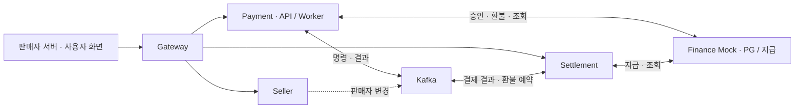

# live-settle

**라이브커머스 판매자를 위한 결제·환불·정산 MSA 플랫폼**

방송·프로모션에 몰리는 결제를 처리하고, 판매자별 매출에서 환불과 수수료를 반영해 정산하는 서비스를 설계합니다. 외부 PG의 지연·응답 유실과 이벤트 중복 상황에서도 거래 상태와 금액을 일치시키는 데 집중합니다.

## 목표 기능

| 영역 | 범위 |
| --- | --- |
| 판매자 | 등록, 로그인·연동 자격, 데이터 접근 권한 |
| 결제 | 접수, 모의 PG 승인, 상태·내역 조회, 멱등 처리 |
| 환불 | 지급 예약 전 전액 환불, 정산금 예약·해제, 결과 확인 |
| 정산 | 매출·환불·수수료 계산, 배치 생성, 모의 지급 |
| 운영 | 미확정 거래 추적, 재처리, 지표·추적 관측 |

판매자는 정산금을 받는 주체이며 여러 방송 계정을 하나의 `sellerId`로 관리할 수 있습니다. 상품·재고·방송·배송은 외부 커머스의 책임입니다. 외부 PG·지급 API는 `finance-mock`으로 대체합니다.

## 서비스 설계



| 서비스 | 책임·데이터 소유권 |
| --- | --- |
| Seller | 판매자·사용자·연동 자격 |
| Payment | 결제·시도 이력·환불·실행 작업·SAGA 조정 |
| Settlement | 거래별 원장·예약·정산 배치·지급 |

Payment API와 Worker는 같은 모듈·DB를 사용하며 각각 확장하는 구조입니다. 서비스 간에는 API·이벤트로 연동하고 다른 서비스의 테이블에 직접 접근하지 않습니다. 내부 코드는 표현·응용·도메인·인프라 4계층으로 나눕니다.

### 정합성 설계

- **중복 방지:** API 멱등키, Inbox와 원장 업무 키에 유니크 제약을 둡니다. 같은 키로 다른 본문이 들어오면 거절합니다.
- **안전한 인계:** 상태와 Outbox를 같은 DB 트랜잭션으로 저장하고, 수신 측은 Inbox·실행 작업을 저장한 뒤 offset을 커밋합니다. 거래 스트림 key는 `paymentId`이며 토픽 간 전역 순서는 가정하지 않습니다.
- **PG 장애 복구:** 외부 호출 동안 DB 잠금을 유지하지 않습니다. 타임아웃만으로 실패를 확정하지 않고 멱등키·상태 조회로 응답 유실을 확인합니다.
- **환불 SAGA:** 정산금 예약→PG 환불→원장 상쇄 순서로 처리합니다. PG 환불이 확정 실패하면 예약을 해제하고, 결과가 미확정이면 예약을 유지합니다. 환불·지급은 같은 항목을 동시에 선점할 수 없도록 설계합니다.
- **금액 보존:** KRW 원 단위 정수와 수수료 5%·원 미만 버림을 프로젝트 가정으로 사용합니다. 거래별 원장에 적용한 정책 버전을 기록하고, 전액 환불은 최초 수수료·순정산액을 상쇄합니다.

## 성능 목표와 검증

로컬 목표는 **승인 완료 1,000 TPS를 15분 유지**하는 시험입니다. 별도 자원을 확보하면 3천·5천·1만 TPS로 확장하고 피크 이후 대기열 배출·복구를 확인합니다.

승인 완료 TPS는 **서로 다른 신규 결제의 PG 승인 결과가 Payment DB에 커밋된 건수**입니다. 접수·조회·재시도 요청 수와 구분합니다.

판매자 2만 곳을 가정한 CSV로 균등 분산과 상위 1%에 결제 70%가 몰리는 부하를 비교합니다. 지연 p95·p99, 정산 반영 지연, Kafka lag, DB·발생기 자원과 `dropped_iterations`를 함께 기록합니다. 종료 후 PG·Payment·Settlement를 대조해 누락·중복·금액 불일치를 검증합니다. `finance-mock`의 지연·실패율은 시험용 가정이며 실제 PG 성능을 뜻하지 않습니다.

## 실행

Java 21, Docker·Compose v2, Python 3가 필요합니다.

```bash
git clone https://github.com/500-internal-server-error-team/live-settle.git
cd live-settle
git switch develop
python3 scripts/init_env.py
./gradlew --continue clean build
docker compose up -d --build --wait --wait-timeout 300
python3 scripts/smoke.py
```

[Swagger UI](http://localhost:8080/swagger-ui.html) · [Zipkin](http://localhost:9411)

Prometheus·Grafana·Kafka-UI는 `docker compose --profile observability up -d --wait`로 실행합니다. k6 도구 확인은 다음 명령을 사용합니다.

```bash
docker compose --profile tools run --rm --no-deps k6
```

Gradle은 포맷·Checkstyle·계층 경계·패키징을 검사합니다. smoke는 기동·DB 접근 경계·Kafka·Redis 왕복·Zipkin 추적 전파를 확인합니다. 기본 k6 스크립트는 명세 조회를 검사하며 결제 완료 TPS와는 별도입니다.

## 기술·개발 안내

Java 21 · Spring Boot · Spring Cloud Gateway · PostgreSQL·Flyway · Kafka · Redis · Micrometer·OpenTelemetry·Zipkin · Prometheus·Grafana · Docker Compose · k6

기술 버전은 [build.gradle](build.gradle)·[Compose](compose.yml)·[앱 Dockerfile](Dockerfile)·[DB Dockerfile](infra/postgres/Dockerfile)을 기준으로 합니다. `.env`는 Git에서 제외하며 비밀번호는 환경 초기화 스크립트로 생성합니다.

- [실행·접속·종료·검증](docs/development.md)
- [서비스·DB·코드 경계](docs/architecture.md)
- [DB 변경 절차](docs/migrations.md)
- [협업 규칙](CONTRIBUTING.md)
- [프로젝트 초안·검증 목표·역할 배분안](docs/proposal.md)
- [상세 설계 초안·범위와 가정·예상 질문](docs/design.md)

## 참고

[Kafka 전달 보장](https://kafka.apache.org/42/design/design/) · [Outbox 이벤트 ID·집계 키](https://debezium.io/documentation/reference/stable/transformations/outbox-event-router.html) · [결제 멱등성](https://docs.tosspayments.com/blog/what-is-idempotency)
